# System Architecture & Flowcharts

> Architecture and end-to-end flows for **CAD → Interactive Hologram**: importing designs
> from CAD / 3D tools, compiling them into labelled exploded point clouds, interacting
> with them by hand, and adding new parts to an existing design.

Companion to [`CAD_IMPORT_BUILD_GUIDE.md`](./CAD_IMPORT_BUILD_GUIDE.md) (the code).
All diagrams are [Mermaid](https://mermaid.js.org/) — they render on GitHub, GitLab and
most Markdown viewers.

---

## Contents

1. [Architecture at a glance](#1-architecture-at-a-glance)
2. [System context](#2-system-context)
3. [Component architecture](#3-component-architecture)
4. [Layered view (compile-time vs run-time)](#4-layered-view-compile-time-vs-run-time)
5. [Data model (ERD)](#5-data-model-erd)
6. [Compile pipeline flowchart](#6-compile-pipeline-flowchart)
7. [Runtime frame loop](#7-runtime-frame-loop)
8. [Gesture state machine](#8-gesture-state-machine)
9. [Interaction sequence — point & inspect](#9-interaction-sequence--point--inspect)
10. [Interaction sequence — pinch, grab, drag](#10-interaction-sequence--pinch-grab-drag)
11. [Add-new-part flow (runtime)](#11-add-new-part-flow-runtime)
12. [Add-new-part flow (build-time)](#12-add-new-part-flow-build-time)
13. [Labels & descriptions resolution](#13-labels--descriptions-resolution)
14. [Build & deploy flow](#14-build--deploy-flow)
15. [Design decisions & rationale](#15-design-decisions--rationale)
16. [Performance budget](#16-performance-budget)
17. [Reuse map from HoloHand](#17-reuse-map-from-holohand)

---

## 1. Architecture at a glance

The system has **two distinct phases**, connected only by a static file format (the
**model pack**):

- **Compile time** (offline, Node CLI or browser compiler page): CAD/3D file → model pack.
- **Run time** (browser): model pack → interactive point cloud.

This separation is the backbone of the whole design. The compiler can be slow, run once,
and use heavy loaders. The runtime stays lean: it only ever reads a binary
`Float32Array` of positions plus a small JSON header.

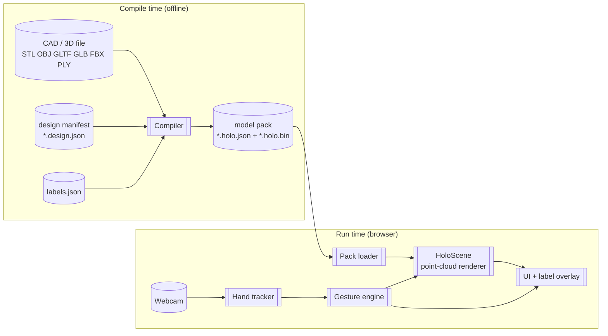

---

## 2. System context

Who and what the app talks to. There is deliberately **no backend** for the core flow.

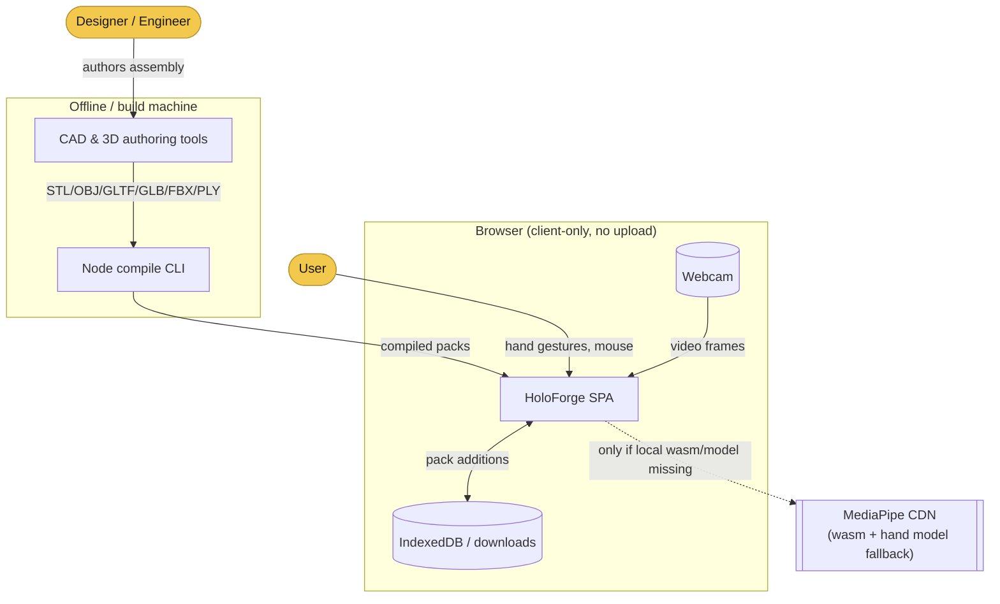

Key context facts:

- The webcam feed **never leaves the browser**; hand landmarks are computed locally.
- The only optional network calls are the MediaPipe WASM/model fallbacks.
- "Packs" are the contract between the offline pipeline and the app.

---

## 3. Component architecture

How the modules depend on each other. The runtime (`scene`, `tracking`, `ui`, `main`) is
decoupled from the compiler (`import`, `compile`). They share only the **pack format**.

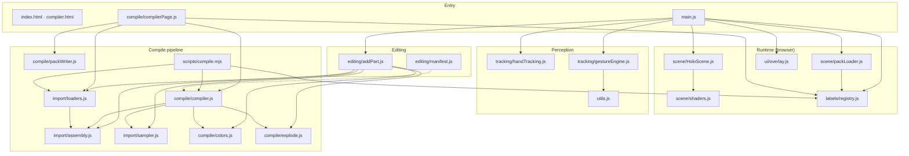

Notice: `import/*` and `compile/*` are **isomorphic** (no DOM APIs except in
`loaders.js`'s browser path and `packWriter.js`), so the same code runs in the Node CLI,
the browser compiler page, and the runtime's runtime-add path.

---

## 4. Layered view (compile-time vs run-time)

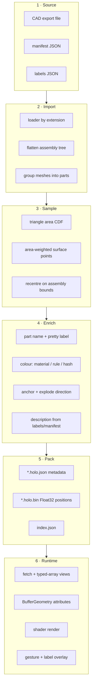

---

## 5. Data model (ERD)

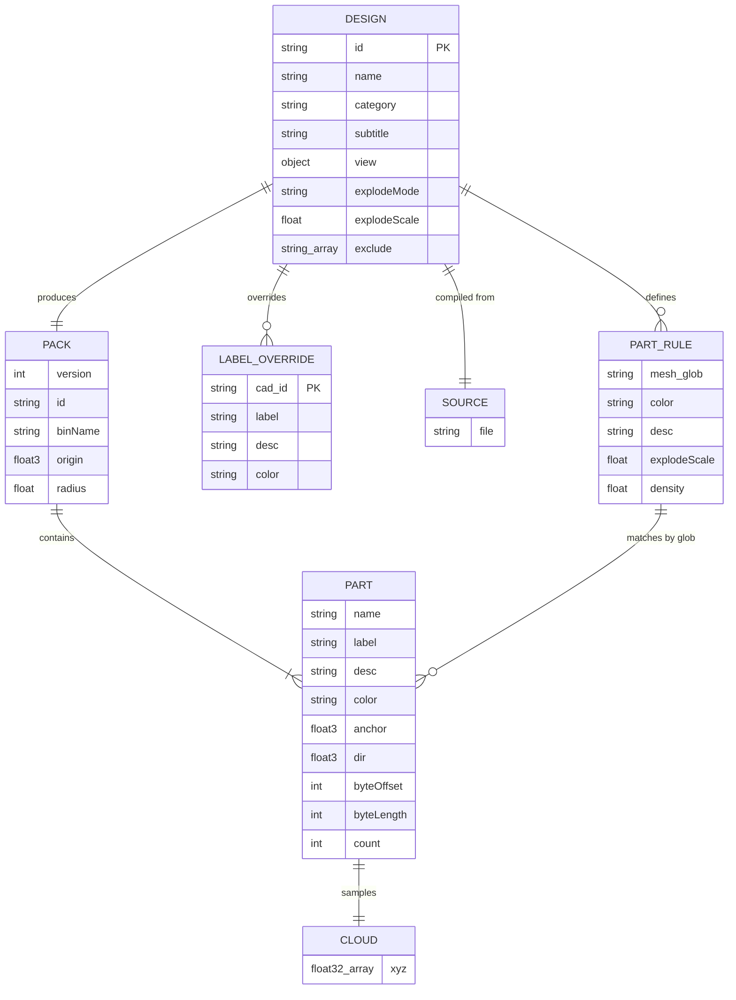

Relationship notes:

- A **`PART_RULE`** (manifest) matches zero-or-more raw CAD meshes by glob; matched meshes
  become one `PART`.
- A **`LABEL_OVERRIDE`** (labels.json) targets a raw CAD id (`name` or `re:regex`) and
  wins over the manifest when the loader resolves labels.
- A `PART` owns exactly one `CLOUD` (after merging all matched meshes).
- `origin` and `radius` live on the `PACK` so parts added later can align to the same
  space and explode by the same scale.

---

## 6. Compile pipeline flowchart

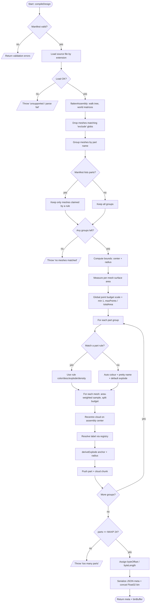

Decision points to watch:

- **Format check** happens in the loader (extension dispatch).
- **`MAXP = 24`** is a hard ceiling set by the shader's `uOff[24]` uniform array.
- **Budget scaling** keeps total points under `maxPoints` regardless of CAD complexity.

---

## 7. Runtime frame loop

Every animation frame, in order. This is HoloHand's loop with the model source swapped.

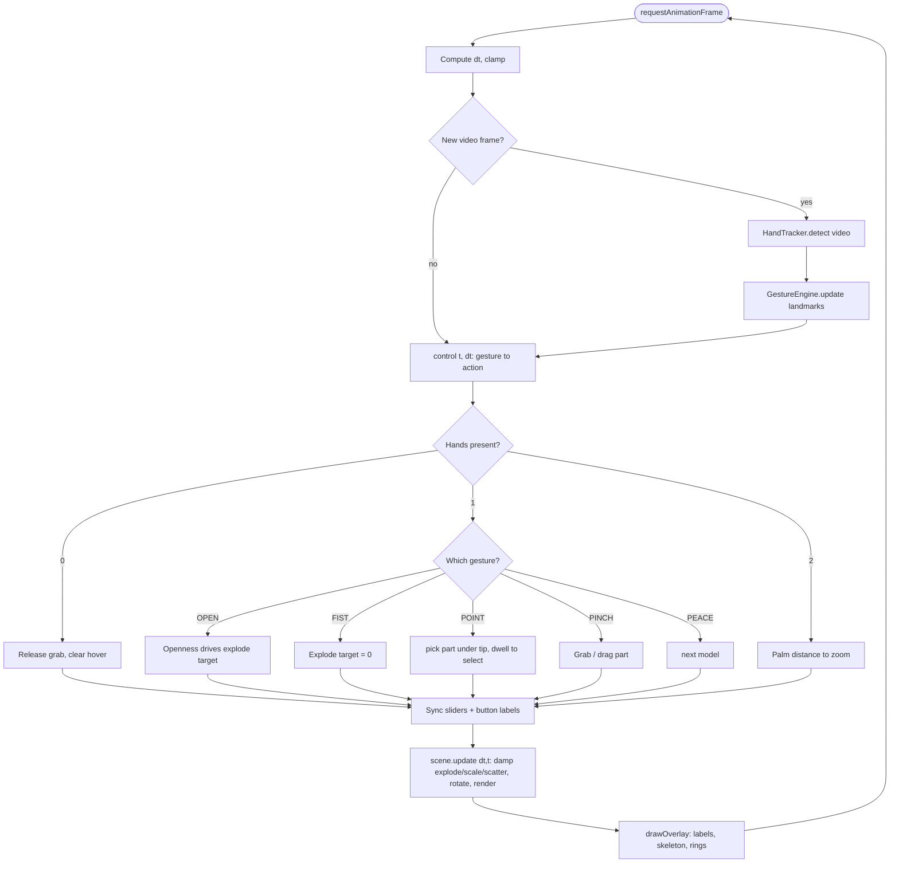

The renderer's `update()` responsibilities:

1. Damp `explode → explodeTarget`, `scale → scaleTarget`, `scatter → scatterTarget`.
2. When scattering between models completes, load the pending pack.
3. Apply inertia / auto-spin when the user is not steering.
4. Lerp per-part drag offsets (`uOff`) back to zero on release.
5. Update shader uniforms and render.

---

## 8. Gesture state machine

Per hand, the gesture engine emits a **stable** gesture after a short streak, so brief
misclassifications don't fire actions. This is the HoloHand state machine, reused.

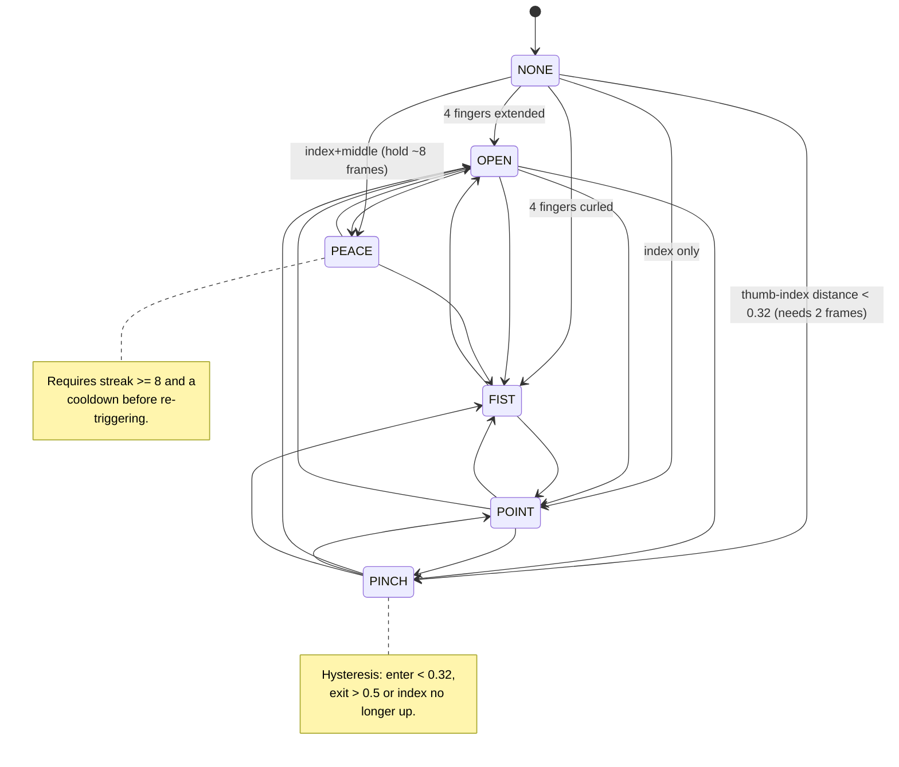

Mapping to actions (from `main.js`):

| Gesture | Action | Renderer call |
|---|---|---|
| `OPEN` | Explode by openness | `scene.explodeTarget = openness` |
| `FIST` | Assemble | `scene.explodeTarget = 0` |
| `NONE` + move | Rotate / tilt | `scene.rotateBy`, `scene.rollBy` |
| `POINT` | Hover, dwell → select | `scene.pick`, `scene.setHover`, `scene.setSel` |
| `PINCH` | Grab / drag part | `scene.dragPart`, `scene.releaseAll` |
| `PEACE` | Next model | `scene.next` |
| two hands | Zoom | `scene.scaleTarget` |

---

## 9. Interaction sequence — point & inspect

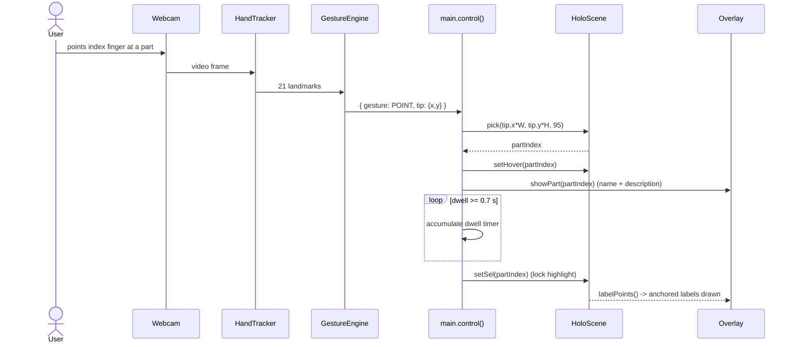

---

## 10. Interaction sequence — pinch, grab, drag

```mermaid
sequenceDiagram
    actor U as User
    participant GE as GestureEngine
    participant M as main.control()
    participant S as HoloScene

    U->>GE: thumb + index touch (PINCH)
    M->>S: pick(pinchPt, 170)
    alt part found (or recent hover)
        M->>S: setSel(idx); setHover(idx)
        M->>M: grab = { part, last }
    end
    loop while pinching and moving
        U->>GE: hand moves
        M->>S: dragPart(idx, dx, dy)
        S->>S: offT[idx] += pixel delta to world
    end
    U->>GE: opens hand (no longer PINCH)
    M->>S: releaseAll()
    S->>S: lerp uOff[idx] back to (0,0,0)
```

The dragged offset lives in `HoloScene.offT[]`; the shader reads the smoothed `uOff[]`
so the part eases back into place when released.

---

## 11. Add-new-part flow (runtime)

```mermaid
flowchart TD
    A([User clicks Add part]) --> B[File picker: stl/obj/ply/glb/gltf/fbx]
    B --> C[loadModelFile -> Object3D]
    C --> D[flattenAssembly]
    D --> E{Meshes found?}
    E -- no --> ERR[/Toast: could not add part/]
    E -- yes --> F{align to pack.origin?}
    F -- yes --> G[subtract stored origin]
    F -- no --> H[subtract this file's own center]
    G --> I[area-weighted sample all meshes]
    H --> I
    I --> J[centroid -> anchor]
    J --> K[deriveExplode anchor + pack.radius]
    K --> L[build part {label, color, dir, anchor}]
    L --> M[scene.appendPart part, cloud]
    M --> N[push into model.build() array]
    N --> O[delete geometry cache, rebuild BufferGeometry]
    O --> P[swap geometry on existing Points]
    P --> Q[releaseAll + onModel refresh UI]
    Q --> R([Part visible + labelled])
    R --> S{Persist?}
    S -- download --> T[serializeCurrentModel -> downloadPack]
    S -- dev server --> U[savePackToDevServer -> public/packs]
    S -- no --> V([In-memory only])
```

Constraint: runtime addition is limited to **24 total parts** per model, because the
shader's `uOff[24]` array is fixed at compile of the shader source. Raising it means
editing `shaders.js` and recompiling all packs consistently.

---

## 12. Add-new-part flow (build-time)

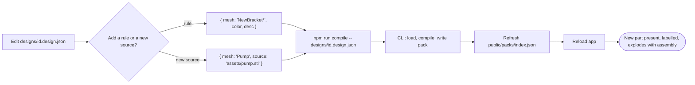

---

## 13. Labels & descriptions resolution

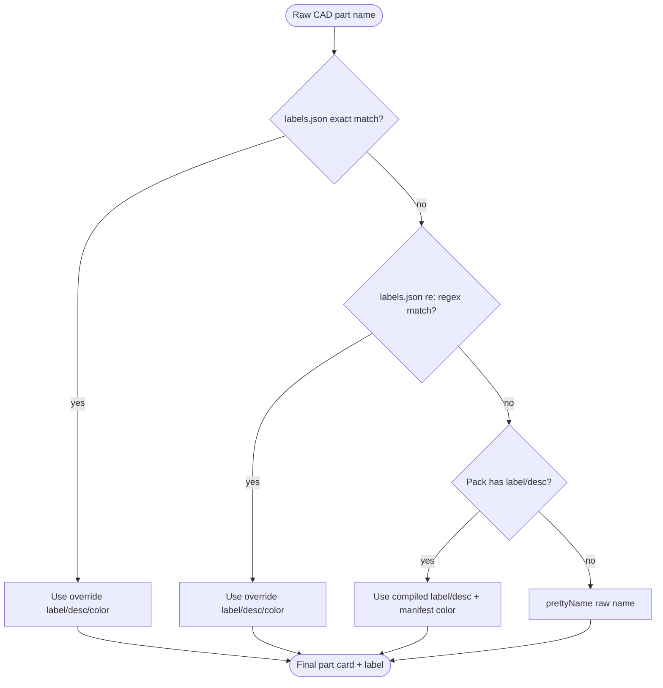

Resolution happens in `packLoader.packToModel` (and again for runtime-added parts).
That means **editing `labels.json` does not require recompiling packs** — a deliberate
choice so documentation and naming can be iterated quickly.

---

## 14. Build & deploy flow

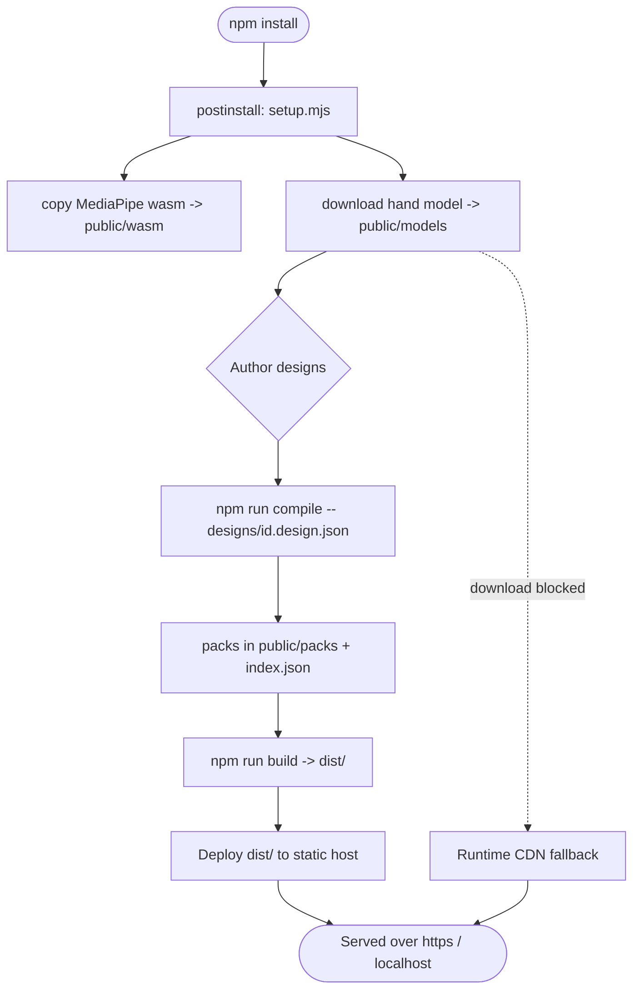

---

## 15. Design decisions & rationale

| Decision | Why |
|---|---|
| **Point clouds, not textured meshes** | Matches HoloHand's aesthetic, gives a uniform "holographic" look across arbitrary CAD sources, and makes picking/labels trivial (anchors are just points). |
| **Pack file = JSON + raw Float32 bin** | Metadata stays readable/diffable; the hot data path is a zero-copy typed-array view. |
| **Area-weighted surface sampling** | Uniform visual density independent of the CAD tessellation (a huge flat face and a tiny one get comparable point spacing). |
| **Compile-time vs run-time split** | Heavy loaders never ship to the runtime; the runtime stays fast and small. |
| **Compiler is isomorphic** | Same `compile/*` and `import/*` code powers the Node CLI, browser compiler page, and runtime-add. One implementation, three entry points. |
| **Labels resolved at load, not compile** | Rename/describe parts without recompiling; keep docs decoupled from geometry. |
| **Reuse HoloHand's renderer & gestures** | The renderer/interaction contract is proven; only the model source changes. |
| **`MAXP = 24` fixed** | Keeps the shader's uniform array static (WebGL-friendly). Appending is allowed up to the cap. |
| **Radial explode by default** | Best generic "exploded diagram" behaviour for arbitrary assemblies; `axial` + per-part overrides cover the rest. |

---

## 16. Performance budget

| Stage | Target | Notes |
|---|---|---|
| Compile (CLI) | < 8 s for 100k-triangle assembly | Sampling dominates; totally offline. |
| Pack size | ≤ 60k points → ~720 KB `.bin` | `maxPoints` budget; tune per device. |
| Runtime load | < 300 ms per pack | Fetch + `new Float32Array(view)`; no parsing. |
| Frame | 60 fps with 2 hands + 24 parts | One draw call for all points; additive blending. |
| Hand tracking | ~30–60 fps | MediaPipe GPU delegate when available. |
| Overlay | < 2 ms | 2D canvas labels + skeleton. |

Points are the dominant cost. If frame time rises, lower `maxPoints`/`pointsPerUnit` or
compile an LOD pack.

---

## 17. Reuse map from HoloHand

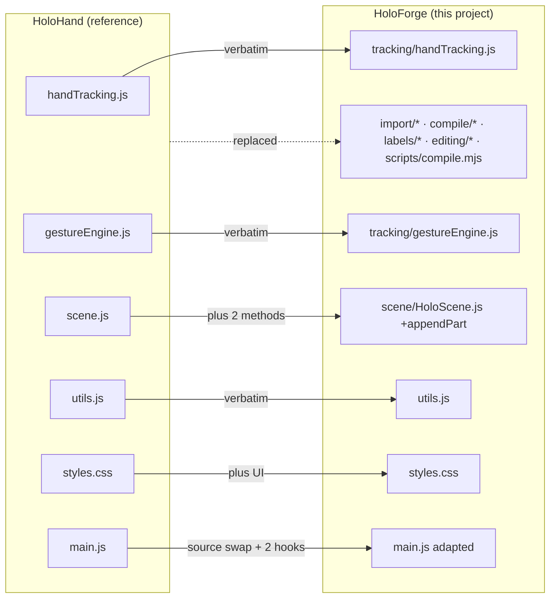

Reused verbatim: MediaPipe wrapper, gesture engine, math utils, shader, pick/explode
logic, mouse/keyboard fallbacks, overlay drawing, UI language.
Replaced: the hand-coded `models/*` geometry (now compiled from CAD).
Added: the entire import/compile/labels/editing pipeline.

---

See [`CAD_IMPORT_BUILD_GUIDE.md`](./CAD_IMPORT_BUILD_GUIDE.md) for the line-by-line
implementation of every module referenced above.
